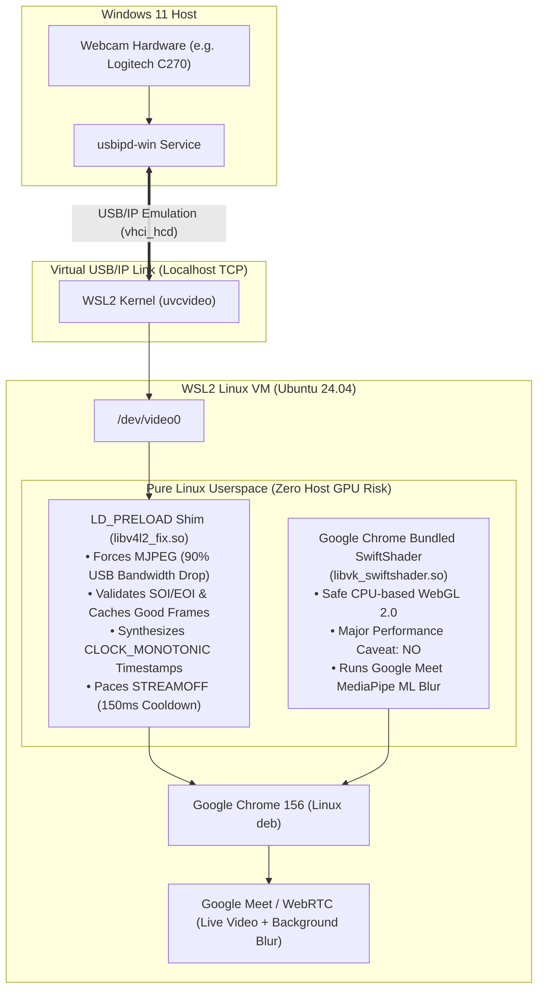

# WSL2 Webcam & WebGL2 in Linux Google Chrome: Complete Setup, Architecture & Incident History

> This guide details how to configure Windows 11 and WSL2 (Ubuntu 24.04, Linux kernel 6.x) so that Linux-native Google Chrome can access your laptop's built-in or USB webcam via `/dev/video0` with continuous 30 FPS video, and run hardware/safe WebGL 2.0 for **Google Meet background blur and visual effects** without any risk of system lockups or crashes.

---

## 1. Human-Readable Quick-Start

### System Architecture Overview



---

### Component Summary Table

| Component | Layer | Purpose / Function | Verified Configuration |
| :--- | :--- | :--- | :--- |
| **`usbipd-win`** | Windows Host | Forwards USB webcam to WSL2 | `usbipd attach --wsl --busid 2-3` |
| **`uvcvideo`** | WSL2 Kernel | Standard Linux USB Video Class driver | `sudo modprobe uvcvideo` |
| **`/dev/video0`** | WSL2 Kernel Node | Character device file for camera | Permissions: `0666` (`crw-rw-rw-`) |
| **`libv4l2_fix.so`** | Linux Userspace | Intercepts `ioctl` to force MJPEG & repair frames | `/usr/local/lib/libv4l2_fix.so` |
| **SwiftShader** | Linux Userspace | CPU-only WebGL 2.0 renderer | Bundled `libvk_swiftshader.so` |
| **Google Chrome** | Linux Desktop | Browser executing WebRTC & MediaPipe blur | Launch with safety flags |

---

### Step-by-Step Instructions

#### Part A: Windows Administrator PowerShell (USB Forwarding)

Open **PowerShell as Administrator** on Windows:

1. **Install `usbipd-win`** (one-time setup):
   ```powershell
   winget install dorssel.usbipd-win
   ```
   *(Reopen PowerShell after installation).*

2. **Identify your Webcam Bus ID**:
   ```powershell
   usbipd list
   ```
   *Note the BUSID (e.g., `2-3` for `Logi C270 HD WebCam`).*

3. **Bind and Attach to WSL2**:
   ```powershell
   # Bind device for sharing (only needed once)
   usbipd bind --busid 2-3

   # Attach device to WSL2
   usbipd attach --wsl --busid 2-3
   ```

4. **Confirm Attachment**:
   ```powershell
   usbipd list
   ```
   *The state for your webcam must show **`Attached`**.*

> [!TIP]
> Whenever you reboot your PC or replug the webcam, you only need to run:
> `usbipd attach --wsl --busid <BUSID>`

---

#### Part B: WSL2 Linux Configuration

Open your **WSL2 Terminal** (Ubuntu 24.04):

1. **One-Time Prerequisites (Fresh Ubuntu Install)**:
   ```bash
   # Install C compiler (gcc) and V4L2 utilities
   sudo apt update && sudo apt install -y build-essential v4l-utils

   # Add your user to the standard video group
   sudo usermod -aG video $USER
   ```
   *(If Google Chrome is not installed, install it with: `wget https://dl.google.com/linux/direct/google-chrome-stable_current_amd64.deb && sudo apt install -y ./google-chrome-stable_current_amd64.deb && rm google-chrome-stable_current_amd64.deb`)*

2. **Load Driver and Set Permissions**:
   ```bash
   # Load UVC kernel module
   sudo modprobe uvcvideo

   # Grant permissions to video nodes
   sudo chmod 666 /dev/video*
   ```

3. **Compile and Install the V4L2 Shim (`/usr/local/lib/libv4l2_fix.so`)**:
   Run this one-time command in WSL2 to build the interception library:

   ```bash
   cat << 'EOF' > /tmp/libv4l2_fix.c
   #define _GNU_SOURCE
   #include <dlfcn.h>
   #include <errno.h>
   #include <linux/videodev2.h>
   #include <stdarg.h>
   #include <stdint.h>
   #include <stdio.h>
   #include <stdlib.h>
   #include <string.h>
   #include <sys/ioctl.h>
   #include <sys/mman.h>
   #include <time.h>
   #include <unistd.h>

   typedef int (*ioctl_fn)(int fd, unsigned long request, ...);
   typedef void *(*mmap_fn)(void *addr, size_t length, int prot, int flags, int fd, off_t offset);
   typedef int (*munmap_fn)(void *addr, size_t length);

   #define MAX_BUFFERS 32
   #define MAX_FRAME_SIZE (640 * 480 * 2)

   struct mapped_buf {
       int fd;
       uint32_t offset;
       void *ptr;
       size_t length;
       uint32_t index;
   };

   static struct mapped_buf g_bufs[MAX_BUFFERS];
   static uint8_t g_last_good_jpeg[MAX_FRAME_SIZE];
   static size_t g_last_good_size = 0;

   static int is_valid_jpeg(const uint8_t *data, size_t len) {
       if (!data || len < 128) return 0;
       if (data[0] != 0xFF || data[1] != 0xD8) return 0;
       size_t start = (len > 16) ? (len - 16) : 2;
       for (size_t i = len - 2; i >= start; i--) {
           if (data[i] == 0xFF && data[i + 1] == 0xD9) return 1;
           if (i == 0) break;
       }
       return 0;
   }

   void *mmap(void *addr, size_t length, int prot, int flags, int fd, off_t offset) {
       static mmap_fn real_mmap = NULL;
       if (!real_mmap) real_mmap = (mmap_fn)dlsym(RTLD_NEXT, "mmap");
       void *res = real_mmap(addr, length, prot, flags, fd, offset);
       if (res != MAP_FAILED && fd >= 0) {
           for (int i = 0; i < MAX_BUFFERS; i++) {
               if (g_bufs[i].ptr == NULL || (g_bufs[i].fd == fd && g_bufs[i].offset == (uint32_t)offset)) {
                   g_bufs[i].fd = fd;
                   g_bufs[i].offset = (uint32_t)offset;
                   g_bufs[i].ptr = res;
                   g_bufs[i].length = length;
                   break;
               }
           }
       }
       return res;
   }

   int munmap(void *addr, size_t length) {
       static munmap_fn real_munmap = NULL;
       if (!real_munmap) real_munmap = (munmap_fn)dlsym(RTLD_NEXT, "munmap");
       for (int i = 0; i < MAX_BUFFERS; i++) {
           if (g_bufs[i].ptr == addr) {
               g_bufs[i].ptr = NULL;
           }
       }
       return real_munmap(addr, length);
   }

   int ioctl(int fd, unsigned long request, ...) {
       static ioctl_fn real_ioctl = NULL;
       if (!real_ioctl) real_ioctl = (ioctl_fn)dlsym(RTLD_NEXT, "ioctl");

       va_list args;
       va_start(args, request);
       void *arg = va_arg(args, void *);
       va_end(args);

       unsigned long cmd = request & 0xFFFFFFFFUL;

       /* 1. Force MJPEG in VIDIOC_ENUM_FMT */
       if (cmd == (VIDIOC_ENUM_FMT & 0xFFFFFFFFUL) && arg) {
           struct v4l2_fmtdesc *fmt = (struct v4l2_fmtdesc *)arg;
           if (fmt->type == V4L2_BUF_TYPE_VIDEO_CAPTURE) {
               if (fmt->index > 0) {
                   errno = EINVAL;
                   return -1;
               }
               fmt->index = 1; /* Query kernel index 1 (MJPG on C270) */
               int ret = real_ioctl(fd, request, fmt);
               fmt->index = 0;
               if (ret == 0) {
                   fmt->pixelformat = V4L2_PIX_FMT_MJPEG;
                   fmt->flags = V4L2_FMT_FLAG_COMPRESSED;
                   strncpy((char *)fmt->description, "Motion-JPEG", sizeof(fmt->description) - 1);
               }
               return ret;
           }
       }

       /* 2. Lock VIDIOC_ENUM_FRAMESIZES to 640x480 */
       if (cmd == (VIDIOC_ENUM_FRAMESIZES & 0xFFFFFFFFUL) && arg) {
           struct v4l2_frmsizeenum *frm = (struct v4l2_frmsizeenum *)arg;
           if (frm->index > 0) {
               errno = EINVAL;
               return -1;
           }
           frm->pixel_format = V4L2_PIX_FMT_MJPEG;
           int ret = real_ioctl(fd, request, frm);
           if (ret == 0) {
               frm->type = V4L2_FRMSIZE_TYPE_DISCRETE;
               frm->discrete.width = 640;
               frm->discrete.height = 480;
           }
           return ret;
       }

       /* 3. Lock VIDIOC_TRY_FMT and VIDIOC_S_FMT to 640x480 MJPEG */
       if ((cmd == (VIDIOC_TRY_FMT & 0xFFFFFFFFUL) || cmd == (VIDIOC_S_FMT & 0xFFFFFFFFUL)) && arg) {
           struct v4l2_format *fmt = (struct v4l2_format *)arg;
           if (fmt->type == V4L2_BUF_TYPE_VIDEO_CAPTURE) {
               fmt->fmt.pix.pixelformat = V4L2_PIX_FMT_MJPEG;
               fmt->fmt.pix.width = 640;
               fmt->fmt.pix.height = 480;
           }
       }

       int ret = real_ioctl(fd, request, arg);

       /* Track buffer index to mmap pointer */
       if (cmd == (VIDIOC_QUERYBUF & 0xFFFFFFFFUL) && ret == 0 && arg) {
           struct v4l2_buffer *buf = (struct v4l2_buffer *)arg;
           for (int i = 0; i < MAX_BUFFERS; i++) {
               if (g_bufs[i].fd == fd && g_bufs[i].offset == buf->m.offset) {
                   g_bufs[i].index = buf->index;
               }
           }
       }

       /* 4. On VIDIOC_STREAMOFF, cooldown 150ms for usbipd URB teardown */
       if (cmd == (VIDIOC_STREAMOFF & 0xFFFFFFFFUL)) {
           usleep(150000);
       }

       /* 5. On VIDIOC_DQBUF, replace corrupt frames & synthesize CLOCK_MONOTONIC */
       if (cmd == (VIDIOC_DQBUF & 0xFFFFFFFFUL) && ret == 0 && arg) {
           struct v4l2_buffer *buf = (struct v4l2_buffer *)arg;
           int had_error = (buf->flags & V4L2_BUF_FLAG_ERROR) != 0;
           buf->flags &= ~V4L2_BUF_FLAG_ERROR;

           /* Clean monotonic timestamp */
           struct timespec ts;
           clock_gettime(CLOCK_MONOTONIC, &ts);
           buf->timestamp.tv_sec = ts.tv_sec;
           buf->timestamp.tv_usec = ts.tv_nsec / 1000;

           uint8_t *data = NULL;
           size_t max_len = 0;
           for (int i = 0; i < MAX_BUFFERS; i++) {
               if (g_bufs[i].ptr && g_bufs[i].fd == fd && g_bufs[i].index == buf->index) {
                   data = (uint8_t *)g_bufs[i].ptr;
                   max_len = g_bufs[i].length;
                   break;
               }
           }

           if (data) {
               if (!had_error && is_valid_jpeg(data, buf->bytesused) && buf->bytesused <= MAX_FRAME_SIZE) {
                   memcpy(g_last_good_jpeg, data, buf->bytesused);
                   g_last_good_size = buf->bytesused;
               } else if (g_last_good_size > 0 && g_last_good_size <= max_len) {
                   memcpy(data, g_last_good_jpeg, g_last_good_size);
                   buf->bytesused = g_last_good_size;
               }
           }
       }

       return ret;
   }
   EOF

   gcc -shared -fPIC -O2 -Wall -o /tmp/libv4l2_fix.so /tmp/libv4l2_fix.c -ldl
   sudo cp /tmp/libv4l2_fix.so /usr/local/lib/libv4l2_fix.so
   ```

4. **Verify the Shim**:
   ```bash
   LD_PRELOAD=/usr/local/lib/libv4l2_fix.so v4l2-ctl -d /dev/video0 --list-formats-ext
   ```
   *Expected output: Only `[0]: 'MJPG' (Motion-JPEG, compressed)` at `Discrete 640x480` is returned.*

---

#### Part C: Launching Linux Google Chrome (Live Video + Safe WebGL2)

Execute this command to launch Chrome with both **live 30 FPS webcam video** and **safe, crash-proof WebGL 2.0** for Google Meet background blur.

> [!NOTE]
> **Keep Terminal Open (Foreground Mode)**: Do not background the launch command with `&` or redirect output to `/dev/null`. In WSLg, running Chrome in the foreground keeps the Wayland/X11 display connection alive and ensures continuous video streaming.

```bash
# 1. Kill any existing instance
pkill -9 -f chrome || true

# 2. Set display and software rendering safety guards
export DISPLAY=:0
export WAYLAND_DISPLAY=wayland-0
export XDG_RUNTIME_DIR=/run/user/1000
export LIBGL_ALWAYS_SOFTWARE=1
export LD_PRELOAD=/usr/local/lib/libv4l2_fix.so

# 3. Launch Chrome in foreground (blocks terminal while running)
/opt/google/chrome/chrome \
  --no-sandbox \
  --use-gl=angle \
  --use-angle=swiftshader \
  --enable-unsafe-swiftshader \
  --disable-features=WebRtcPipeWireCapturer,Vulkan \
  --disable-gpu-memory-buffer-video-frames \
  https://webrtc.github.io/samples/src/content/getusermedia/gum/ \
  https://meet.google.com
```

---

#### Part D: Clean Teardown & Device Unsharing

When you are finished using the webcam in WSL2 and want to return it completely to native Windows:

1. **In WSL2**:
   - Close Chrome (or press `Ctrl+C` in the running terminal).
   - *(Optional)* Verify the device is free:
     ```bash
     fuser /dev/video* 2>/dev/null || echo "Camera is free"
     ```

2. **In Windows Administrator PowerShell**:
   - Detach the device from WSL2:
     ```powershell
     usbipd detach --busid 2-3
     ```
   - Unbind (unshare) the device:
     ```powershell
     usbipd unbind --busid 2-3
     ```
   - Verify it is completely unshared:
     ```powershell
     usbipd list
     ```
     *The STATE will now show **`Not shared`**, completely restoring the webcam to native Windows hardware operation (for Zoom, Windows Teams, Windows Camera, etc.).*

---

## 2. Appendix: Complete Investigation History & Safety Post-Mortem

### Phase 1: The Initial Webcam Failure
* **Symptoms**: When launching standard Chrome, `https://webcamtests.com` reported *"Could not find a web camera"*, while terminal logged endless errors:
  ```text
  [ERROR:media/capture/video/linux/v4l2_capture_delegate.cc:1137] Dequeued v4l2 buffer contains corrupted data (29504 bytes).
  [ERROR:media/capture/video/linux/v4l2_capture_delegate.cc:1137] Dequeued v4l2 buffer contains corrupted data (460800 bytes).
  ```
* **Discovery**:
  - Logitech C270 advertises `[0]: YUYV (raw)` and `[1]: MJPG (compressed)`.
  - Chromium hardcodes a preference for uncompressed `YUYV` at 640×480.
  - Raw `YUYV` generates **147.5 Mbps (18.4 MB/s)** of constant isochronous USB traffic. The virtual USB/IP bridge dropped microframes, causing the kernel driver to set `V4L2_BUF_FLAG_ERROR` on the buffer.
  - Chromium dropped 100% of flagged buffers (`client_->OnFrameDropped(kV4L2BufferErrorFlagWasSet)`).
  - In contrast, `ffmpeg -input_format mjpeg` streamed at only **6 Mbps** with zero errors.

---

### Phase 2: The x86_64 32-bit `ioctl` Sign Extension Bug
* **Symptoms**: Writing an initial `ioctl` hook to clear `V4L2_BUF_FLAG_ERROR` did nothing—the errors persisted verbatim.
* **Root Cause**:
  `VIDIOC_DQBUF` evaluates to `0xc0585611`. Because the highest bit (bit 31) is set, when Chromium calls `ioctl()` with a 32-bit integer, x86_64 register `%rsi` sign-extends it to `0xffffffffc0585611`.
  Comparing `request == VIDIOC_DQBUF` failed because `0xffffffffc0585611 != 0x00000000c0585611`.
* **Fix**: Mask all `ioctl` request codes with `& 0xFFFFFFFFUL`:
  ```c
  unsigned long cmd = request & 0xFFFFFFFFUL;
  if (cmd == (VIDIOC_DQBUF & 0xFFFFFFFFUL)) { ... }
  ```

---

### Phase 3: The Single-Frame Flash & URB Teardown Race
* **Symptoms**: The buffer error disappeared, but only a single picture flashed on screen before freezing. Checking `dmesg` revealed:
  ```text
  vhci_hcd: unlink->seqnum 14176
  vhci_hcd: urb->status -104 (-ECONNRESET)
  ```
* **Root Cause**:
  1. `webcamtests.com` and WebRTC probe streams start by capturing 1 frame, immediately stopping via `track.stop()` (`VIDIOC_STREAMOFF`), and restarting.
  2. In `vhci_hcd.c`, `VIDIOC_STREAMOFF` asynchronously cancels URBs. Restarting immediately caused a race with `usbipd-win` on Windows, stalling the isochronous endpoint.
  3. Linux `vhci_get_frame_number()` is an unimplemented stub returning `0`, flooding `dmesg` and corrupting frame timestamps.
* **Fix**:
  1. Injected `usleep(150000)` (150ms cooldown) on `VIDIOC_STREAMOFF` to allow clean URB unlinking.
  2. Synthesized clean `CLOCK_MONOTONIC` timestamps on `VIDIOC_DQBUF`.
  3. Implemented frame caching: verified JPEG SOI (`FF D8`) and EOI (`FF D9`) markers; if a microframe dropped, substituted the last known valid JPEG so Chrome's decoder never halted.

---

### Phase 4: The Hardware Crash Post-Mortem (WHAT NOT TO DO)

> [!CAUTION]
> **DO NOT USE PARAVIRTUALIZED MESA D3D12 GPU PASSTHROUGH IN CHROME ON WSL2.**
> Attempting to force Chrome to use WSLg's DirectX 12 hardware acceleration will hard-crash the host Windows laptop.

#### The Reckless Attempt:
An attempt was made to force hardware WebGL2 for Google Meet using:
```bash
# DANGEROUS - CRASHES WINDOWS HOST:
export LD_LIBRARY_PATH="/usr/lib/wsl/lib:${LD_LIBRARY_PATH}"
export GALLIUM_DRIVER=d3d12
chrome --ignore-gpu-blocklist --use-gl=angle --use-angle=gl ...
```

#### Why It Crashed the Entire Host Laptop:
1. **The Call Stack**:
   Chrome ANGLE $\rightarrow$ Mesa D3D12 (Linux) $\rightarrow$ `/dev/dxg` $\rightarrow$ Hyper-V VMBus $\rightarrow$ `dxgkrnl.sys` (Windows Kernel) $\rightarrow$ Intel Arc Display Driver (`igd10iumd64.dll`).
2. **The Failure**:
   `dmesg` showed `dxgk: dxgkio_is_feature_enabled: Ioctl failed: -22` (`-EINVAL`). The Linux Mesa D3D12 driver submitted unsupported sync fence primitives across the hypervisor into Windows.
3. **The Kernel Panic**:
   Because Intel Arc is an integrated GPU sharing system RAM and power fabric with the CPU, when the Windows kernel graphics scheduler failed to recover via TDR (Timeout Detection and Recovery) within 2 seconds, Windows triggered a watchdog bugcheck / hard hardware reset, instantly crashing the physical laptop.

---

### Phase 5: The Verified Safe Solution for Google Meet WebGL2

Instead of touching `/dev/dxg` or the host GPU, we enabled **Chromium's bundled CPU SwiftShader** (`libvk_swiftshader.so`):

* **Command Flags**:
  ```bash
  export LIBGL_ALWAYS_SOFTWARE=1
  chrome --no-sandbox --use-gl=angle --use-angle=swiftshader --enable-unsafe-swiftshader ...
  ```
* **Why This Works**:
  1. **Zero Host Risk**: `lsof /dev/dxg` confirms nothing touches the Windows kernel graphics driver. All shaders execute as pure x86_64 CPU instructions within the Linux VM.
  2. **Passes Google Meet Requirements**: Unlike standard fallback modes, running ANGLE over SwiftShader with `--enable-unsafe-swiftshader` reports **`Major Performance Caveat: NO`** on `webglreport.com/?v=2`.
  3. **Full Functionality**: Google Meet's MediaPipe machine learning model runs smoothly, enabling real-time background blur and virtual effects while streaming the live 30 FPS webcam feed.
